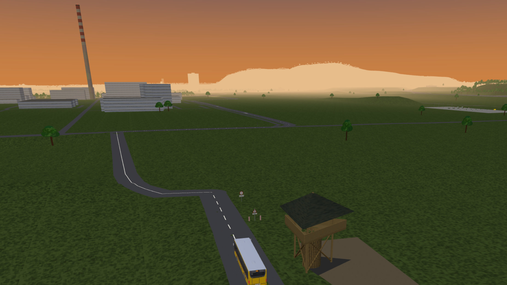
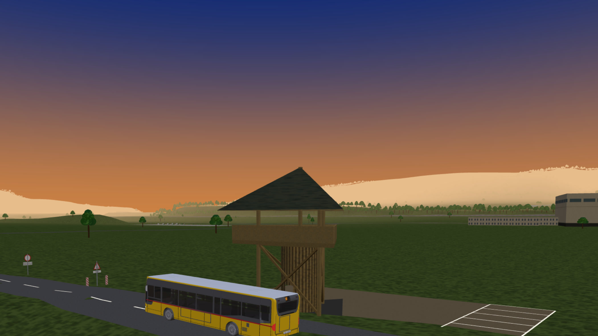
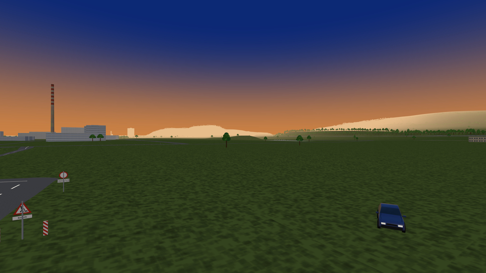

# Rhyflitzer – Map Madness

An open-world arcade racing game for the browser, in the spirit of Midtown Madness 1. Race through real towns built from open geodata, starting at home on the Hochrhein: Bad Säckingen, Stein, Sisseln and Sisslerfeld, with the Rhine and the old wooden bridge right in the middle.

Later: pick any region on a map, and the game builds it into a world you can race.

Dedicated to my daughter.

## Screenshots and videos

**Plattform Sisslerfeld**

  
  
  

**Videos:** [YouTube playlist „Rhyflitzer – Map Madness"](https://www.youtube.com/playlist?list=PLZK1QeqP1C2E)

## Status

Early prototype.

- `index.html`: playable three.js prototype (single file, buildless). Hochrhein layout (Sisseln, Sisslerfeld, Stein, Bad Säckingen) from OpenStreetMap when `data/world_hochrhein.json` exists (built by `pipeline/osm.py`), hand-traced fallback otherwise; checkpoint race, two graphic styles (T), synthesized sound. Serve it over HTTP (`python -m http.server`) and open it in a browser.
- A second region, **Ehrendingen** AG (with the Wanderweg and Im Böndlern), is chosen on the start screen or with `?region=ehrendingen`; the Hochrhein stays the default. See [docs/11](docs/11-pipeline-osm.md).
- `pipeline/terrain.py`: pipeline step 1, measured terrain from swisstopo and LGL. See [docs/08](docs/08-pipeline-terrain.md).
- `pipeline/osm.py`: pipeline step 2, OSM world (roads, Rhine, bridges, buildings, landmarks, markings) as one JSON file the prototype loads automatically. See [docs/11](docs/11-pipeline-osm.md).

## Idea in short

- **Arcade, not simulation**: lots of grip, big jumps, forgiving crashes
- **Real places**: buildings, roads and terrain from OpenStreetMap, swisstopo and LGL Baden-Württemberg, plus hand-built landmarks
- **Forbidden shortcuts**: the pedestrian-only Holzbrücke is fair game
- **Two graphic styles**, switchable: chunky MM1 retro and a soft, atmospheric low-poly look
- **Modes** from MM1: Checkpoint, Blitz, Circuit, Cruise
- **Region editor** (`editor/`): drag a frame on a swisstopo map of Switzerland, get a playable world — see `docs/04-region-editor.md`

## Tech

three.js, vanilla JS, buildless. Rapier (WASM) for vehicle physics. A separate data pipeline turns geodata into game tiles. Self-hosted.

## Docs

| Document | Content |
|---|---|
| [Status and next steps](docs/10-status-and-next-steps.md) | **Start here:** decisions, prototype internals, known issues, next steps |
| [Background](docs/00-background-midtown-madness.md) | Midtown Madness, fan-made European cities, why this project exists |
| [Concept](docs/01-concept.md) | Pillars, modes, graphic styles, starting region, hero assets |
| [Data sources](docs/02-data-sources.md) | OSM, swisstopo, LGL; what each provides; licenses |
| [Technical architecture](docs/03-tech-architecture.md) | Stack, hard parts, performance, large worlds, terrain LOD |
| [Region editor](docs/04-region-editor.md) | Player-picked regions, pipeline design, limits |
| [Glossary](docs/05-glossary.md) | Graphics and geodata terms explained |
| [Project glossary](docs/12-project-glossary.md) | Our own names: places and landmarks, game features, world data, workflow |
| [Photo capture](docs/06-photo-capture.md) | Photogrammetry, GoPro street capture, texture source licences |
| [Brands and permissions](docs/07-brands-and-permissions.md) | Logos, trademarks, who to ask, permission tracker |
| [Pipeline: terrain](docs/08-pipeline-terrain.md) | swissALTI3D + LGL DGM1 → `.mmh` heightmap |
| [Design workflow](docs/09-design-workflow.md) | Claude Design ↔ CLI round trip, tokens, rules, checklist |
| [Pipeline: OSM world](docs/11-pipeline-osm.md) | Geofabrik extract + osmium → `world_hochrhein.json` (roads, water, buildings, anchors) |
| [UI mockups](design/mockups/README.md) | Claude Design artboards: title, setup, car select, HUD, results, style sheet |
| [Ideas](ideas.md) | Loose ideas, not yet planned |

## Datenschutz / Privacy

Das Spiel und der Region-Editor (`editor/`) zählen Besuche mit **Umami**, selbst gehostet auf einem Server in **Deutschland** (`stats.freaxnx01.ch`). Es werden keine Cookies gesetzt und keine personenbezogenen Daten gespeichert. Im **Spiel** werden gezählt: das gewählte Fahrzeug und dessen Wechsel, der gestartete Spielmodus und sein Ende (Zeit auf 5 Sekunden gerundet), die Fortbewegung (Auto, zu Fuss, Helikopter, Dampflok, Hideout, Gebäude), Sprungziele, die Sprache sowie Region, Gerätetyp und Herkunftsseite (Referrer, Kampagnen-Tags `utm_*`). Im **Editor**: die Namen der Gemeinden des Rahmens, seine Grösse und die Lage seines Mittelpunkts auf etwa 5 km gerundet, nie die genauen Koordinaten und nie die Welt-ID. Weder im Spiel noch im Editor wird die Adresszeile mit Abfrageteil (`?world=`, `?bbox=`) übermittelt. Die IP-Adresse wird nicht gespeichert, sondern nur kurzzeitig für die Bestimmung von Land und Region verwendet. Browser mit „Do Not Track“ werden nicht gezählt. Wird das Skript blockiert, läuft alles unverändert weiter.

The game and the region editor (`editor/`) count visits with **Umami**, self-hosted on a server in **Germany** (`stats.freaxnx01.ch`). No cookies are set and no personal data is stored. In the **game** it counts: the chosen vehicle and changes of it, the started game mode and its end (time rounded to 5 seconds), how you get around (car, on foot, helicopter, steam loco, hideout, building), jump targets, the language, plus region, device type and referrer (campaign tags `utm_*`). In the **editor**: the names of the frame's Gemeinden, its size and the position of its centre rounded to about 5 km, never the exact coordinates and never the world id. Neither the game nor the editor sends the address with its query part (`?world=`, `?bbox=`). The IP address is not stored, only used briefly to determine country and region. Browsers with „Do Not Track“ are not counted. If the script is blocked, everything runs unchanged.

## License

- **Code**: [MIT](LICENSE.md)
- **Geodata** keeps its own license and requires attribution:
  - © OpenStreetMap contributors, [ODbL](https://opendatacommons.org/licenses/odbl/)
  - © swisstopo
  - Datengrundlage: LGL, www.lgl-bw.de ([dl-de/by-2-0](https://www.govdata.de/dl-de/by-2-0))
- **Hand-made assets** (models, textures, sounds): license to be decided once the first ones exist
- **Third-party 3D models** keep their own license, are credited here and in the game, and live under `assets/models/`:
  - „Eiffel Tower" ([skfb.ly/AIU9](https://skfb.ly/AIU9)) by Johnson Martin, [CC BY 4.0](http://creativecommons.org/licenses/by/4.0/); converted to metal/rough and compressed (meshopt), materials replaced in-game (see `assets/models/eiffel_tower.LICENSE.txt`)
  - „Atomium" ([3D Warehouse](https://3dwarehouse.sketchup.com/model/68a2be51efafd7a5b3132afb1c62c517/Atomium)) by Sebastian S. (SketchUp 3D Warehouse, 2013); the surrounding terrain patch is removed from the file, otherwise unchanged (see `assets/models/atomium.LICENSE.txt`)
  - „RMS Titanic" ([Sketchfab](https://sketchfab.com/3d-models/rms-titanic-f0a6aa63294f45a2bf330c28502b2b67)) by Union, [CC BY 4.0](http://creativecommons.org/licenses/by/4.0/); decimated and compressed (meshopt), otherwise unchanged (see `assets/models/titanic.LICENSE.txt`)
  - „Enterprise D 2 8 Simple Bake Export" ([Sketchfab](https://sketchfab.com/3d-models/enterprise-d-2-8-simple-bake-export-02aeda1aaafd4a3591892ed5a2aeac33)) by HaughtyGrayAlien, [CC BY 4.0](http://creativecommons.org/licenses/by/4.0/); scaled to life size, decimated, textures converted to WebP and compressed (meshopt), otherwise unchanged (see `assets/models/enterprise_d.LICENSE.txt`)
  - „2020 Mazda 3 Hatchback" ([skfb.ly/pAOpM](https://skfb.ly/pAOpM)) by OUTPISTON, [CC BY-NC-SA 4.0](http://creativecommons.org/licenses/by-nc-sa/4.0/); simplified, repainted and without the badges, in the game as the **Hatchback** car (`assets/hatchback.glb`, see `assets/hatchback.LICENSE.md`). The modified model file stays under CC BY-NC-SA 4.0, and because of it **the game must stay non-commercial** (no paid release, no paid downloads).
  - „Mr Bean Car FBX" ([Sketchfab](https://sketchfab.com/3d-models/mr-bean-car-fbx-428dfc665ab4473fa1cdc42e498e64b2)) by Sxi.Sai, [CC BY 4.0](http://creativecommons.org/licenses/by/4.0/); rescaled to 3.05 m, recoloured to Citron Green, the boot sticker removed, textures shrunk, in the game as the **Little Classic** car (`assets/mini.glb`, see `assets/mini.LICENSE.md`)
  - „Mercedes+CITARO+II+RATP" ([Sketchfab](https://sketchfab.com/3d-models/mercedescitaroiiratp-93010eea7663482e8f1ca17168af6d8a)) by moussasy.sy715, [CC BY 4.0](http://creativecommons.org/licenses/by/4.0/); repainted to a yellow Swiss regional bus look, logos, stickers and lettering removed, wheels simplified, in the game as the **Regional Bus** (`assets/bus.glb`, see `assets/bus.LICENSE.md`)
  - „Ford Model T Downloadable" ([Sketchfab](https://sketchfab.com/3d-models/ford-model-t-downloadable-8cb1c1243c394144837a15f4722a2867)) by Libau Media (robinmikart), [CC BY 4.0](http://creativecommons.org/licenses/by/4.0/); rescaled to the real 2.54 m wheelbase, new plain materials, a tail lamp added, in the game as the **Tin Lizzie** car (`assets/modelt.glb`, see `assets/modelt.LICENSE.md`)
  - „2013 Hyundai - i20 WRC" ([3D Warehouse](https://3dwarehouse.sketchup.com/model/4082138f-6179-4762-ba76-d2910a315f27)) by D3NK, [3D Warehouse General Model License](https://3dwarehouse.sketchup.com/tos/); rescaled to the real 2.57 m wheelbase, simplified, emblems removed, painted in our own rally livery, in the game as the **Rhy Rally** car (`assets/rally.glb`, see `assets/rally.LICENSE.md`)
  - „VW Beetle Florida v2" ([Sketchfab](https://sketchfab.com/3d-models/vw-beetle-florida-v2-aa3c40db85234d1c9b261c5734ea99a9)) by Libau Media (robinmikart), [CC BY 4.0](http://creativecommons.org/licenses/by/4.0/); rescaled to the real 2.40 m wheelbase, new plain materials, the front wheels turned straight, the open door closed, the licence plate and a timeslip sticker blanked, in the game as the **Ladybug** car (`assets/beetle.glb`, see `assets/beetle.LICENSE.md`)
  - „1998 Volkswagen New Beetle" ([Sketchfab](https://sketchfab.com/3d-models/1998-volkswagen-new-beetle-81d1dbbf18e841a184c51f028e652879)) by ddiaz-design, [CC BY-NC-SA 4.0](http://creativecommons.org/licenses/by-nc-sa/4.0/); rescaled to the real 2.51 m wheelbase, simplified, new plain materials with a paintable body, the emblems and brake calipers removed, in the game as the **Rhy Bubble** car (`assets/newbeetle.glb`, see `assets/newbeetle.LICENSE.md`). The modified model file stays under CC BY-NC-SA 4.0.
  - „Batmobile-The Dark Knight Tumbler" ([Sketchfab](https://sketchfab.com/3d-models/batmobile-the-dark-knight-tumbler-7ae346a9724a40faa467a3107dfb09e9)) by Gravity Jack, [CC BY 4.0](http://creativecommons.org/licenses/by/4.0/); rescaled to the film car's 4.57 m length, wheels split into their own nodes, plain glass and lamp materials, textures compressed, in the game as the **Rhy Tumbler** car without any logo (`assets/tumbler.glb`, see `assets/tumbler.LICENSE.md`)
  - „2012 BMW 1M" ([Sketchfab](https://sketchfab.com/3d-models/2012-bmw-1m-b011893b8f8049568610be2abb3ecf8e)) by OUTPISTON, [CC BY-NC-SA 4.0](http://creativecommons.org/licenses/by-nc-sa/4.0/); rescaled to the real 2.66 m wheelbase, new plain materials with a paintable body, the badges removed, in the game as the **Rhy Coupé** car (`assets/coupe.glb`, see `assets/coupe.LICENSE.md`). The modified model file stays under CC BY-NC-SA 4.0.
  - „Free Bugatti Chiron" ([Sketchfab](https://sketchfab.com/3d-models/free-bugatti-chiron-374890e62c5a44e9a739ca638b6e0a18)) by ALIEEEN, [CC BY 4.0](http://creativecommons.org/licenses/by/4.0/); rescaled to the real 2.711 m wheelbase, simplified, new plain materials with a paintable body, the badge removed, in the game as the **Rhy Hyper** car (`assets/hyper.glb`, see `assets/hyper.LICENSE.md`).
  - „McLaren P1" ([Sketchfab](https://sketchfab.com/3d-models/mclaren-p1-e791b5aee5c6497c83994f4e5f1db84b)) by hartwelkisaka, [CC BY 4.0](http://creativecommons.org/licenses/by/4.0/); rescaled to the real 2.67 m wheelbase, simplified, new plain materials with a paintable body, the number plate removed, wheels split into their own nodes, in the game as the **Rhy Papaya** car (`assets/mclaren.glb`, see `assets/mclaren.LICENSE.md`).
  - „Chevrolet Caprice Classic Sedan" ([Sketchfab](https://sketchfab.com/3d-models/chevrolet-caprice-classic-sedan-96200ce146014b858e2b284c123bbe42)) by popit228fm, [CC BY 4.0](http://creativecommons.org/licenses/by/4.0/); rescaled to the real 2.946 m wheelbase, new plain materials and our own flame livery, a push bar and tail lamps added, the badges and the number plate removed, wheels split into their own nodes, in the game as the **Rhy Bulldog** car (`assets/bulldog.glb`, see `assets/bulldog.LICENSE.md`).
  - „Reliant-regal-supervan" ([Sketchfab](https://sketchfab.com/3d-models/reliant-regal-supervan-6c868a7d53d04f04a6319ec016a05c10)) by 3DDomino, [CC BY 4.0](http://creativecommons.org/licenses/by/4.0/); rescaled to a 2.17 m wheelbase, simplified, new plain materials with a paintable body, the badge removed, the wheels in their own nodes (the front wheel as two halves), in the game as the **Rhy Wobbler** car (`assets/wobbler.glb`, see `assets/wobbler.LICENSE.md`).
  - „Magirus D serie mixer truck" ([Sketchfab](https://sketchfab.com/3d-models/magirus-d-serie-mixer-truck-2816fbf6ca4d489592282b77dbf1c28e)) by Randonavt, [CC BY 4.0](http://creativecommons.org/licenses/by/4.0/); rescaled to 1.07 m tyres, simplified, plain materials beside the cab and drum livery, the number plates removed, six wheels and the drum in their own nodes, in the game as the **Rhy Mixer** truck (`assets/mixer.glb`, see `assets/mixer.LICENSE.md`).
  - „XYZ School - NY marathon - Coca-Cola truck" ([Sketchfab](https://sketchfab.com/3d-models/xyz-school-ny-marathon-coca-cola-truck-ec3b1538e99848a39153c8533a5658ff)) by leslava, [CC BY 4.0](http://creativecommons.org/licenses/by/4.0/); taken out of its diorama, levelled, the bent trailer straightened, fairy lights and tail lamps added, the ten wheels in their own nodes; the model carries no brand, logo or lettering, and neither does the game. In the game as the **Rhy Fizz** truck (`assets/fizz.glb`, see `assets/fizz.LICENSE.md`).
  - „Harvester Near Completion" ([Sketchfab](https://sketchfab.com/3d-models/harvester-near-completion-cc4bf1104f2840ddad4b3aaa68fc3f74)) by webbsketches, [CC BY 4.0](http://creativecommons.org/licenses/by/4.0/); rescaled to 1.8 m front tyres, simplified, plain materials with a paintable body (the textures and a small emblem on them removed), the wheels and the reel in their own nodes, in the game as the **Rhy Harvester** combine (`assets/harvester.glb`, see `assets/harvester.LICENSE.md`).
  - „KITT - Knight Rider" ([Sketchfab](https://sketchfab.com/3d-models/kitt-knight-rider-60443abd88ef4cb7ab1df9ac5f622a36)) by thenerdybirdy, [CC BY 4.0](http://creativecommons.org/licenses/by/4.0/); rescaled to a 2.565 m wheelbase, plain materials in the interior, the number plate painted out of the texture, the lamps split off by their texture colour, the scanner light rebuilt as eight segments that sweep, the wheels in their own nodes, in the game as the **Rhy Knight** car (`assets/knight.glb`, see `assets/knight.LICENSE.md`).
  - „Low Poly Fire Truck" ([Sketchfab](https://sketchfab.com/3d-models/low-poly-fire-truck-688b7c17a0e54a05b0b2d51a8aee061b)) by jg-3d, [CC BY 4.0](http://creativecommons.org/licenses/by/4.0/); turned and re-centred, new plain materials, the blank front number plate removed, the blue lights split to flash in turn, the wheels in their own nodes, in the game as the **Rhy Blaze** fire engine (`assets/blaze.glb`, see `assets/blaze.LICENSE.md`).

Not affiliated with Microsoft, Angel Studios or Rockstar Games. Midtown Madness is a trademark of its respective owner.
