# Vehicle style test: detailed car models against the game's look

Style test for #368, run 2026-10-22 on the GPU browser. The deliverable is this note; no game
code changed, no model file is committed. Inputs for #236 (own car) and #364 (ambient traffic).

**Question:** does a detailed Sketchfab car clash with the "Original" (MM2, 2000) look, and do
the own car and the traffic match each other? **Short answer: no clash at ~20k triangles once the
chrome is gone and the windows are opaque; the traffic has to come from Quaternius, not Kenney,
or the two never match.**

## What was tested

| Candidate | Source | Licence | Triangles | Materials / textures | File |
|---|---|---|---|---|---|
| Mazda 473k | Sketchfab "2020 Mazda 3 Hatchback" by OUTPISTON (#236), only badges neutralised, metres, x forward | CC BY-NC-SA 4.0 | 468 431 | 26 / 2 (2048², 1024²) | 16 MB |
| Mazda 21k | same, flatten + join + weld + `meshopt` simplify (ratio 0.031, error 0.03) | CC BY-NC-SA 4.0 | 21 530 | 19 / 2 (512²) | 491 KB |
| Mazda 5k | same, ratio 0.0115, error 0.5, no textures (tyre and brake maps become plain colours) | CC BY-NC-SA 4.0 | 5 324 | 19 / 0 | 107 KB |
| Mazda 21k matte | the 21k with matte paint (metalness 0, roughness 0.65) and every chrome trim turned to grey plastic | CC BY-NC-SA 4.0 | 21 528 | 21 / 2 | 492 KB |
| Kenney sedan, Kenney SUV | [Kenney Car Kit 3.1](https://kenney.nl/assets/car-kit) (`sedan.glb`, `suv.glb`, scaled ×1.65 / ×1.6 to ~4.2 m) | CC0 (License.txt in the zip) | 2 032 / 2 474 | 1 / 1 shared `colormap.png` | 4.8 MB zip, 45 models |
| Quaternius car 1, car 2 | [Quaternius "Cars" pack](https://quaternius.com/packs/cars.html), `NormalCar1` (4.22 m, scale 1) and `NormalCar2` (scale ×1.25); GLBs via the poly.pizza mirror [m/Cz6yDaUcM9](https://poly.pizza/m/Cz6yDaUcM9) and [m/unqqkULtRU](https://poly.pizza/m/unqqkULtRU) | CC0 1.0 (pack page and both mirror pages) | 2 954 / 3 124 | 6 / 0, 7 / 0 | 165 KB, 174 KB |

Every Mazda variant is in metres, 4.46 m long, wheels on y = 0, front along +x like the game's
own car. The body panels in the Sketchfab file are "Machine Gray Metallic", which the game's light
renders near-black, so all four got the same red paint on that material (#236 plans a paint picker
on it anyway). The 21k, 5k and matte variants also have **opaque dark windows** (no
`KHR_materials_transmission`, which would cost three.js an extra render pass per frame) and opaque
lamp glass; the 473k keeps the original transmission windows.

Badges (#236): the front emblem became a black plate in the grille (its four meshes are now
`BlackChrome`), the rear emblem is body-coloured and flush, the three rear lettering meshes are
deleted, and the `RimBadges` texture is gone (plain dark hub discs). Visible in the close-ups
below: nothing brand-shaped is left. The interior survives in every variant (the 21k keeps its
seats and dash, see `closeup-bumper-*`), which the cockpit camera of #236 will need.

Quaternius' own download is a Google Drive folder (Blend, FBX, OBJ only, no GLB); on the test
day Drive answered "quota exceeded" for every file, so the two GLBs came from poly.pizza, which
hosts the same models under the same CC0 licence (a third Quaternius car there, m/HQ0hvRM2XR, is
CC-BY 3.0 and was skipped). Kenney's GLBs reference an external `Textures/colormap.png`.

## Setup

The game was served from this worktree with two things that are not committed: a copy of
`prototype/index.html` with one appended line that exposes `scene`, `camera`, `car`, the car
materials, `startRace`, the camera views and `groundH` on `window.__st`, and a `/st/` route for
the model files. A Playwright script connected to the GPU browser over CDP (as
`prototype/tests/gpu_browser.py` does), loaded each GLB with the game's own `GLTFLoader` +
`MeshoptDecoder` from the import map, gave every loaded material the game's car environment map
(`CAR_ENV`, intensity `STYLES.original.carEnv`), recomputed smooth normals where the file has
none, and placed the cars relative to the player with `window.__mm.place`. HUD, nav and toasts
were hidden; the labels are canvas sprites. "Original" style, default daylight, 1280 × 720.

Spots: the Sisseln Hauptstrasse in the village (world 1829, −284.5, heading west) for everything
up to 12 m, and the 640 m straight of the same road east of Sisseln towards Kaisten (world 2270,
−314.5, heading east) for the distance rows. The game's compact is the player car in every shot.

## Screenshots

Full-size PNGs are in the session scratchpad (`styletest/shots/`); these are 800 px JPEGs.

### The Mazda family next to today's car

Chase cam, the four variants 12 m ahead facing the player:

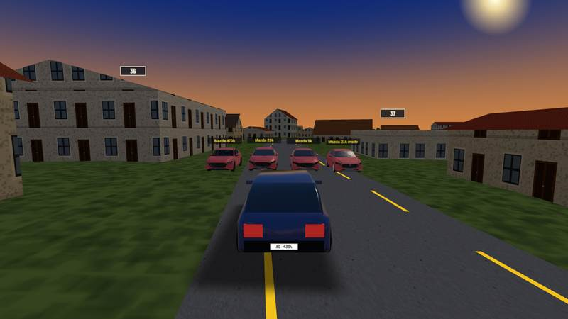

Driver's view, same row, then the row 9 m ahead seen from behind:

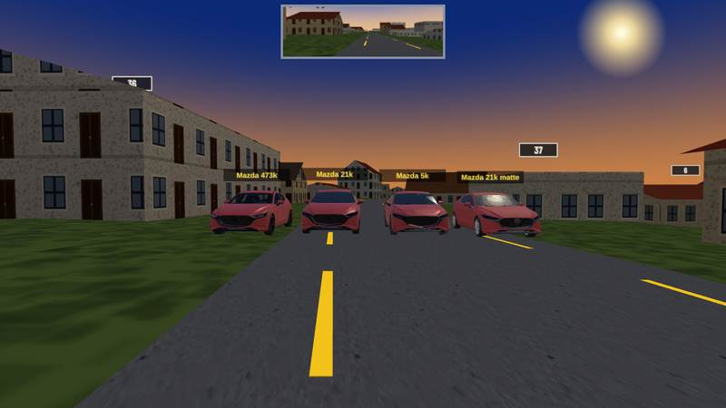

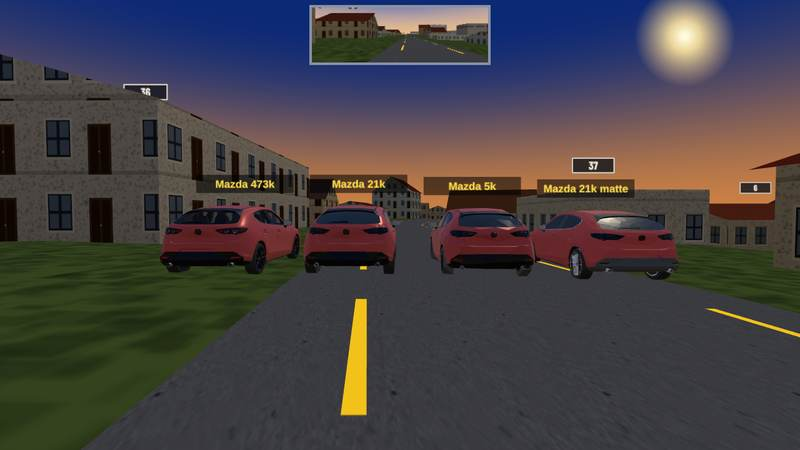

### Close-ups (driver's eye, 5 m; bumper cam, 7 m)

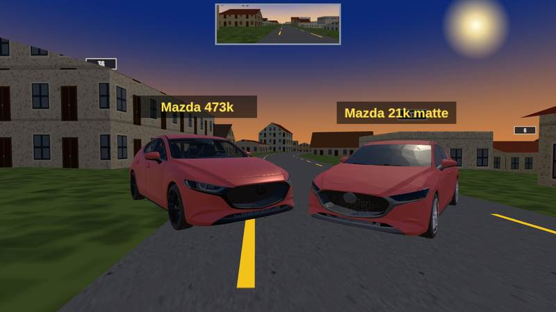

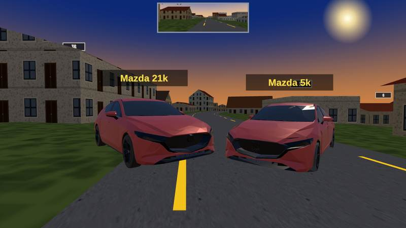

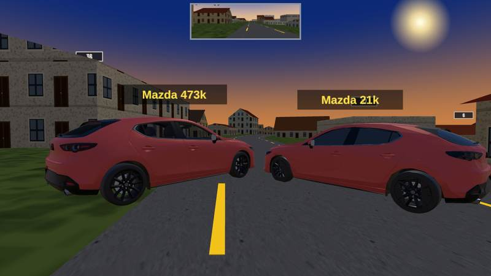

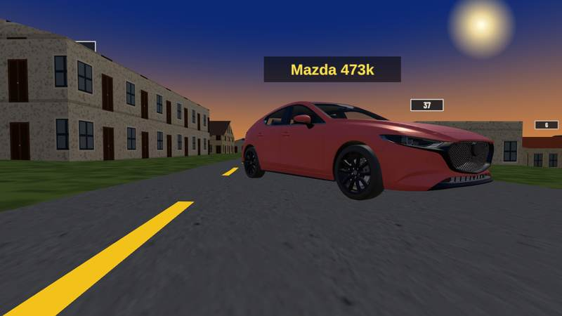

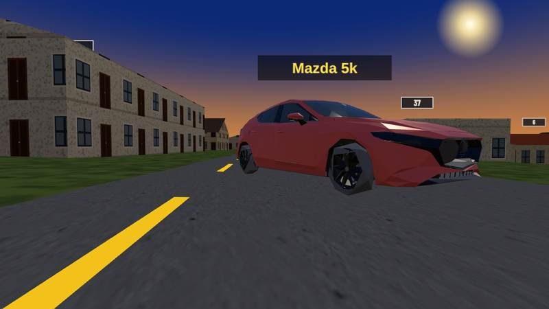

### Traffic candidates next to the 21k Mazda and today's car

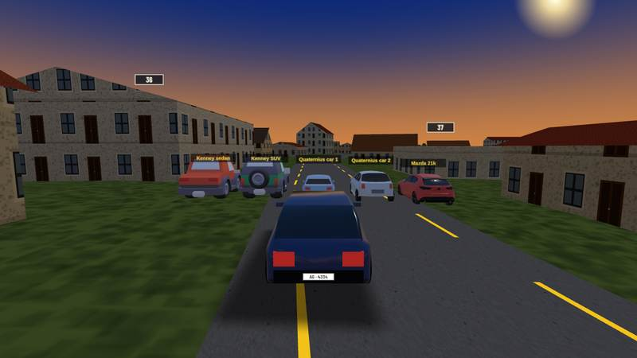

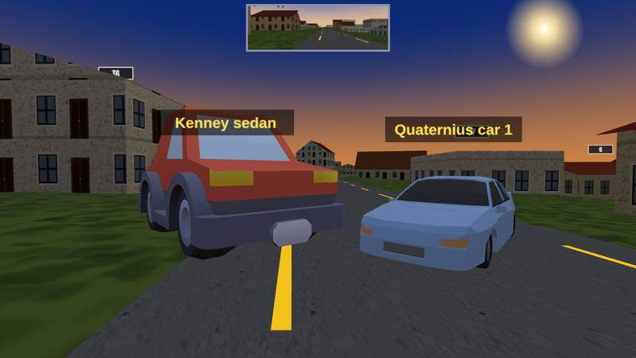

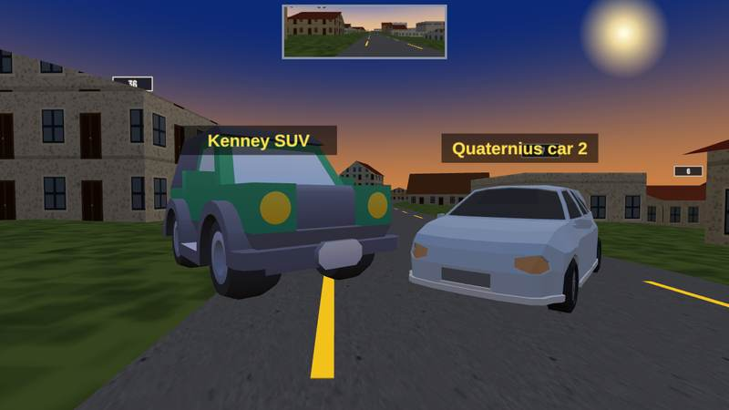

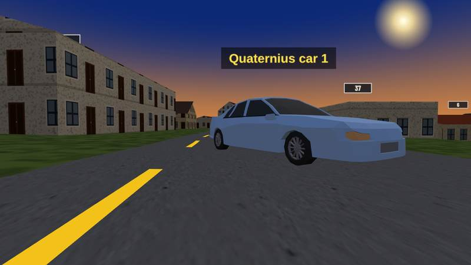

### Distance and fog

Rows at 40 m and 120 m (chase cam), at 250 m and 450 m (the fog of the Original style runs
320 → 1400 m), and the drone view over rows at 160 m and 320 m:

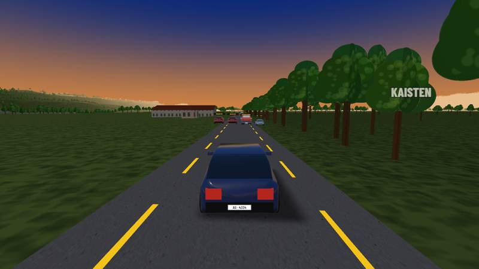

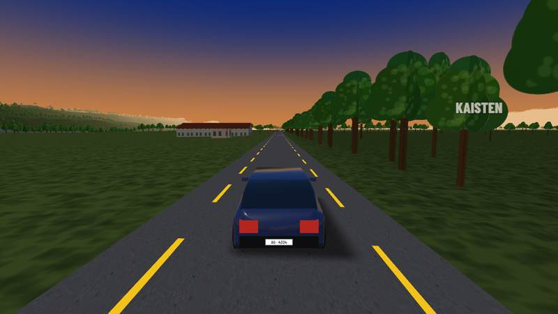

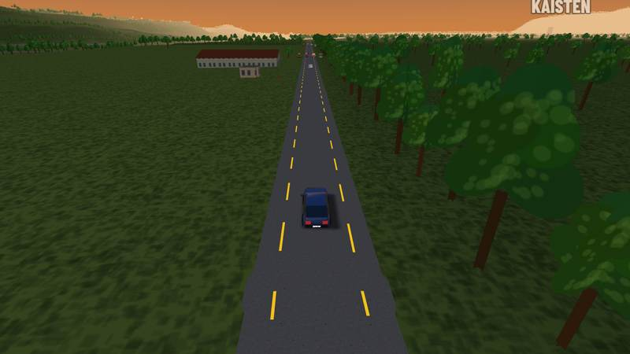

## What the pictures show

1. **473k vs 21k: no visible difference from 5 m on.** In the bumper close-up at 7 m the two
   are the same car; the 21k only loses the honeycomb of the grille (it becomes a dark surface)
   and some headlamp internals. From the chase cam (the hero car sits 7 m in front of it all the
   time) nothing distinguishes them.
2. **5k holds the silhouette but facets.** At 5–7 m the headlamps go flat, the bonnet gets a
   kink, the rims lose their spokes (plain discs). From 9 m on it still reads as the same car;
   at 40 m it is identical to the others. Fine for traffic or a distance LOD, not for the hero
   car that is always in the foreground.
3. **Chrome is the one thing that says "Sketchfab".** The chrome grille surround and window
   trims put hard white highlights on the 473k/21k that nothing else in the world has. The matte
   variant (grey plastic trims, flat paint) sits visibly closer to the game's own compact and to
   the Quaternius cars. The paint itself is less decisive: today's compact already has a clearcoat
   with the same environment reflection, so a mild gloss on the Mazda matches it; fully matte
   paint looks slightly dull next to it.
4. **The detailed Mazda does not clash with the world.** Flat-coloured buildings, hard fog, and
   a smooth low-poly car next to a smooth high-poly car in the same light: in every shot the
   Mazda reads as "the better-made car in the same game", not as a foreign object. The MM2 target
   (smoother shading, more polygons, hard fog) absorbs it.
5. **Kenney and the Mazda do clash. Quaternius and the Mazda do not.** The Kenney Car Kit cars
   are toy proportions: 2.1 m tall and 2.4 m wide at 4.2 m length, wheels half the body height,
   a cartoon colormap. Next to the Mazda or today's compact they look like a different game.
   The Quaternius cars have real proportions (1.8 × 1.2 × 4.2 m), a 1990s sedan shape, flat
   colours and ~3k triangles: next to today's compact they look like siblings, next to the 21k
   Mazda like the cheaper cars on the same street, which is exactly the MM2 relation between the
   player car and the traffic.
6. **Beyond ~150 m the model does not matter.** At 250 m a car is 5–8 px, at 450 m a coloured
   dot already dimmed by the fog; at 320 m from the drone it is a smear. The three.js fog applies
   to the loaded GLTF materials exactly as to the game's own, so there is no "pop" at the fog
   edge. Only silhouette and paint colour survive the distance.
7. **Frame time on the GPU browser (Radeon Vega 11, 1280 × 720):** baseline ~18 ms; with any one
   of the loaded cars, 5k, 21k or 473k, ~34 ms; with all eight ~37 ms. The jump is a vsync step
   (one extra 16.7 ms frame), not a triangle cost: 5k and 473k land on the same number, and the
   measurement in `window.__mm.frameMs` cannot resolve below a frame. On this integrated GPU
   the triangle count of a single car is not what sets the frame time; the draw-call and shader
   count is (the Sketchfab file has 146 meshes and 26 materials, the joined 21k has 19 of each).

## Proposed vehicle budget

| | Own car (hero, always in frame) | Traffic car | Why |
|---|---|---|---|
| Triangles | **≤ 25 000** (the 21k variant) | **2 000–4 000** | 21k is indistinguishable from 473k at 5 m and beyond; 5k facets at < 9 m |
| Draw calls / materials | **≤ 8** by role: paint, glass, dark trim, lamps, rims, tyres, interior, lights | **1–2** (one vertex-coloured mesh, or body + wheels) | draw calls, not triangles, are what the GPU browser measured; the Sketchfab file's 146 meshes are the real cost |
| Textures | **none required**; at most one 512² map (tyre tread) | **none** (flat colours or a shared 256² palette atlas per set) | the game's world is flat-coloured; a 2048² body map adds 22 MB of VRAM for nothing visible |
| Materials | `MeshStandardMaterial` / `MeshPhysicalMaterial` with the game's `CAR_ENV` env map; **no chrome** (metalness ≤ 0.25 on paint, trims as grey plastic), **opaque dark windows** (#133), **no `KHR_materials_transmission`**, no `BLEND` lamps | `MeshStandardMaterial`, roughness ≥ 0.6, same env map at the same intensity so paint sheen matches the hero | chrome and transparent windows are the two things that look foreign; everything else blends |
| Wheels | separate nodes (4), not joined into the body | separate nodes | #236 needs rolling and steering; the test's `join` step must keep them apart |
| File size | **≤ 500 KB** uncompressed GLB, ≤ 250 KB with `EXT_meshopt_compression` (the game's loader already carries the decoder, see `loadModel`) | ≤ 200 KB | lazy-loaded on the car select / first spawn |
| LOD | optional 5k variant for the car-select turntable and for the car seen at > 40 m in multiplayer | none needed | one LOD suffices for traffic at these counts |

With a traffic radius of a few hundred metres and the density rule of #364 (vehicle length ÷
road length per class) a street scene carries maybe 20–40 traffic cars: 60–120k triangles and
20–80 draw calls, well under what the OSM buildings already cost.

## Recommendation

**#236 (own car): take the ~21k variant**, built from the Sketchfab file with the pipeline below,
plus the matte trims from the fourth variant: grey plastic instead of chrome, paint with a mild
gloss (metalness ~0.25, roughness ~0.35, clearcoat as today's compact has), opaque dark windows,
badges neutralised as done here. Not the 473k (16 MB, 146 draw calls, transmission windows) and
not the 5k (facets in the foreground). Keep the four wheel nodes out of the join.

**#364 (traffic): Quaternius "Cars" pack (CC0).** `NormalCar1` at scale 1, `NormalCar2` at
×1.25; the pack has more bodies (SUV, Taxi, SportsCar) in the same style. Pull the GLBs from the
poly.pizza mirror or convert the OBJs; record the Drive folder and the mirror page per model in
the credits. Not the Kenney Car Kit: CC0 and tidy, but the toy proportions never sit next to a
real-proportioned hero car, and the game would have to go fully cartoon to use them.

## Pipeline that produced the variants

`@gltf-transform/cli` 4.5.1 via `npx` and a 60-line node script in the scratchpad (not committed;
`gltf-transform` can do all of it from the CLI except the per-mesh material reassignment). The
steps that mattered, for #236 to reproduce:

1. Neutralise badges: reassign the emblem meshes to the black trim material, delete the lettering
   meshes, drop the `RimBadges` texture (mesh names are in the Sketchfab file, `Object_118/114/
   196/224` front, `Object_298/260` rear emblem, `Object_248/292/252` rear lettering).
2. Units and frame: wrap the scene in one node scaled 4.46 / 28.13, rotated +90° about y so the
   file's +z (front) becomes +x, translated so the bbox is centred and sits on y = 0.
3. Materials: windows opaque, transmission extension removed; lamp glass opaque; body paint on
   `Machine_Gray_Metallic`.
4. **Strip `NORMAL`, `TANGENT` and the unused `TEXCOORD_0` from every untextured primitive before
   welding.** Sketchfab's split normals leave every face its own island and `meshopt` cannot
   collapse across them: with them, the simplifier stalls at ~80k triangles whatever the ratio
   and error; without them it reaches 21k. The game recomputes smooth normals on load.
5. `dedup` → `flatten` → `join` → `weld({ tolerance: 0.0005 })` →
   `simplify({ simplifier: MeshoptSimplifier, ratio: 0.031, error: 0.03, lockBorder: false })` →
   `textureCompress({ resize: [512, 512], targetFormat: 'jpeg' })` → `prune`.
6. For a 5k version the tyre and brake-disc textures have to go too (uv seams block the collapse
   the same way split normals do): ratio 0.0115, error 0.5.

## Loose ends noted, not acted on

- The Quaternius Drive download was blocked by Google's quota on the test day; whoever does #364
  should keep a local copy of the pack once it downloads.
- `window.__mm.frameMs` cannot measure below the vsync step on the GPU browser; a GPU timer
  query (`EXT_disjoint_timer_query_webgl2`) would be needed for a real per-car cost.
- The hand-traced START pose of the vehicle tests (`test_vehicles.py`) is on the same Sisseln
  road used here; a future vehicle screenshot test could reuse the two poses above.
