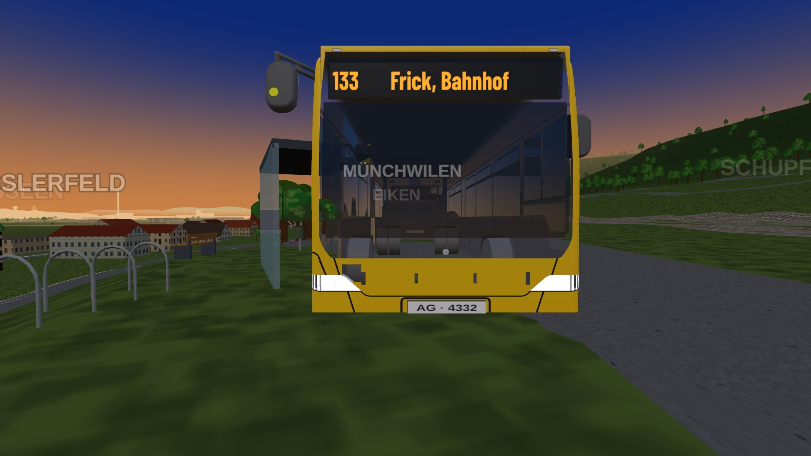
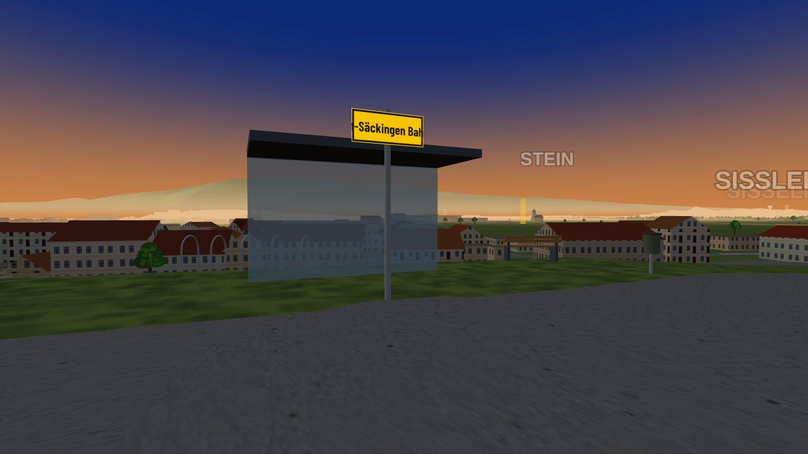
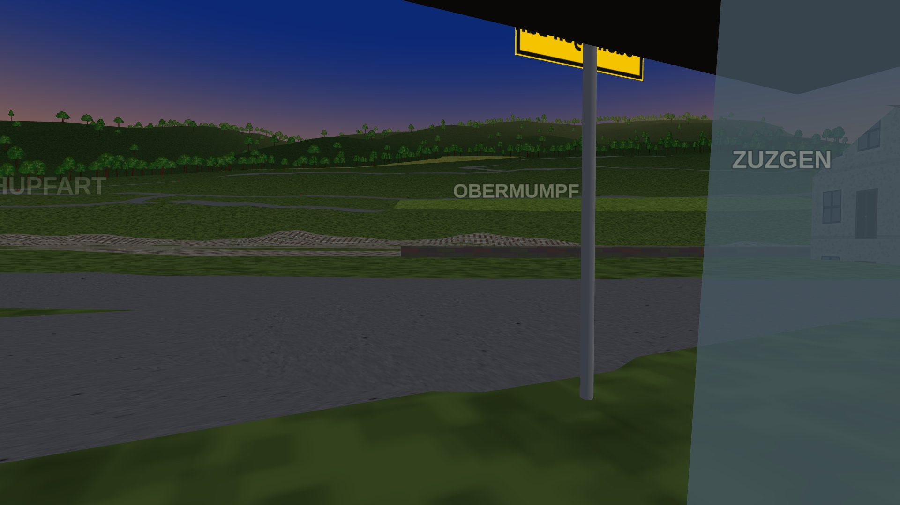
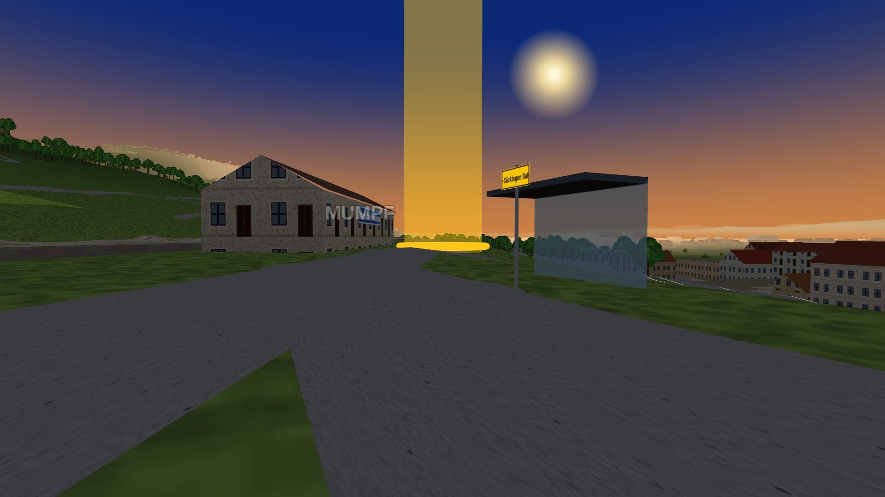

# Postauto display look check (#713)

Look check for the #713 fix (PR of 2026-11-07): a Postauto's line and destination now sit in the
glTF's own `Display` quads (front, side, rear) instead of the #500 LED plane in front of the
windscreen. Run 2026-11-07 headless with SwiftShader (`--use-angle=swiftshader`); the shots and
the pixel analysis below are the evidence, the structural checks live in
`tests/test_postauto.py::test_postauto_display_uses_the_models_own_slot`.

**Question:** does every display position show `133` + destination flush in the model's own
slot, with no second display and no baked „811 Sisseln"?
**Short answer: yes** — front, side and rear each carry one orange-on-dark display with the
trip's text; the plane is gone and the cached glTF material is untouched.

## Setup

`?patime=05:50` (the first stop of trip `11533941:21120`, line 133 to Frick, Bahnhof), the clock
frozen with Playwright's `set_fixed_time` while the bus stands, so the fleet holds still for the
camera (rAF keeps firing frozen, so frames still render — probed: ~9 frames in 5 s). The
player's car was placed facing each display position and the **cockpit eye view** (C C) put the
camera ~3–3.5 m from each display plane — the chase cam trails the car by ~6.9 m and can never
come that close. Shots 1920 × 1080 via the game's own `__mm.photoUrl()` (a `page.screenshot`
starves under SwiftShader).

## Screenshots

### Front

The display quad projects to 570 × 107 px here; the band search finds the text at offset
(+2, −19) px from the pitch-less projection — flush in the model's slot.

### Side

One flank carries the side display (as the model has it, spec A6), the other is plain bodywork:

### Rear

The rear shows the line number only (its UV window is u 0.004..0.22):

## What the pictures show (pixel analysis, headless)

Colour classes: display orange (`g/r` 0.45–0.72, the LED `#ff9a1a` is 0.60), lit Postauto yellow
(`g/r` ≥ 0.72, the body `#ffcc00` is 0.80), dark (max channel < 60). The numbers are SwiftShader's;
on a real GPU the text is crisper.

| Position | Band found | Orange text | Dark background | Verdict |
|---|---|---|---|---|
| Front | 570 × 107 px, offset (+2, −19) from the projected quad | 0.14 | 0.84 | flush in the model's front slot, `133` + destination |
| Side (display flank) | 240 × 64 px band | 0.14 | 0.69 | one display, `133` + destination |
| Side (other flank) | none | — | — | plain bodywork, no second display |
| Rear | 60 px band in the rear quad | 0.31 | 0.66 | line number only, as on the model |

Structural (from the Playwright test, on the same frozen scene): `planes = 0` (the #500
`PlaneGeometry` LED is gone), `displays = 1`, `own = true`, `ownMap = true` (the quad material is
a clone with its own 1024 × 128 canvas texture), `flipY = false`, `led = { line: "133", dest:
"Frick, Bahnhof" }`, and the cached glTF `Display` map is still 512 px wide — the player's bus
(#478) keeps its baked display untouched.

## Loose ends noted, not acted on

- The side display renders on the flank the issue's table calls right (+z) as seen from the
  model's frame; which world side that is was not re-measured here (the shots label it only as
  "the flank with/without the display").
- The quad projections in this note's analysis ignore the bus's small pitch (rotation.z of the
  group); at 3.5 m that costs ~20 px, visible in the front offset (−19).
- A `page.screenshot` starves under SwiftShader (30 s timeout, fonts loaded, no frame);
  `window.__mm.photoUrl()` is the working capture path and is what the visual tests use.