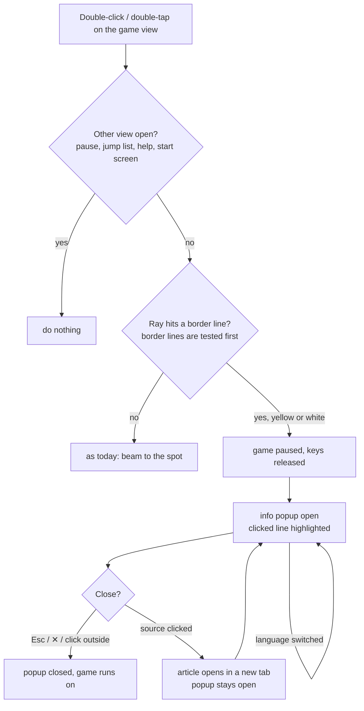
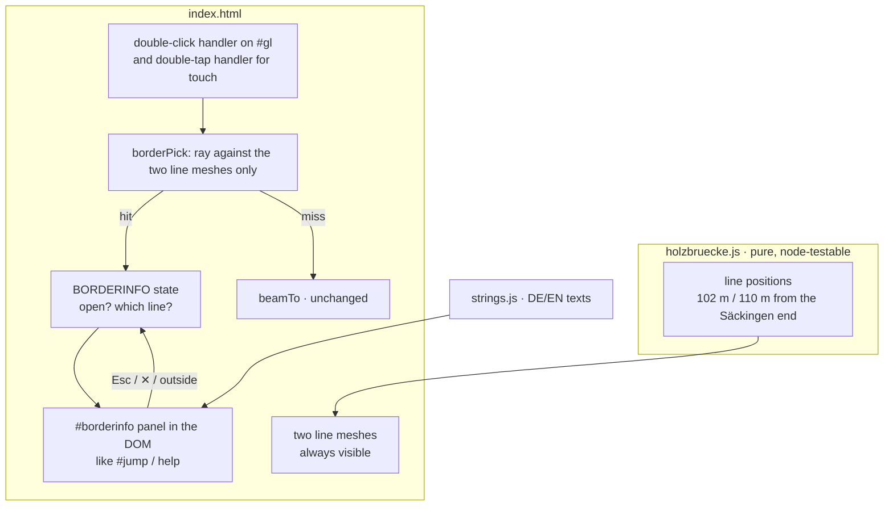

# Border info popup — flow (#396)

Approved by the maintainer 2026-10-20 (phase 2). Wireframe: [wireframe.md](wireframe.md).

**Key rule:** a double-click / double-tap on `#gl` already beams the car (#165). The border lines are picked **first**; only when the ray misses them does the beam run, unchanged.

## User journey

## Components and state

## Screen inventory

- No screen beyond the popup; sources are external links in a new tab.
- No error or empty states: the texts are static in the game, nothing is loaded.
- While open the game is paused like the jump list (J); it does not switch to the pause menu.
