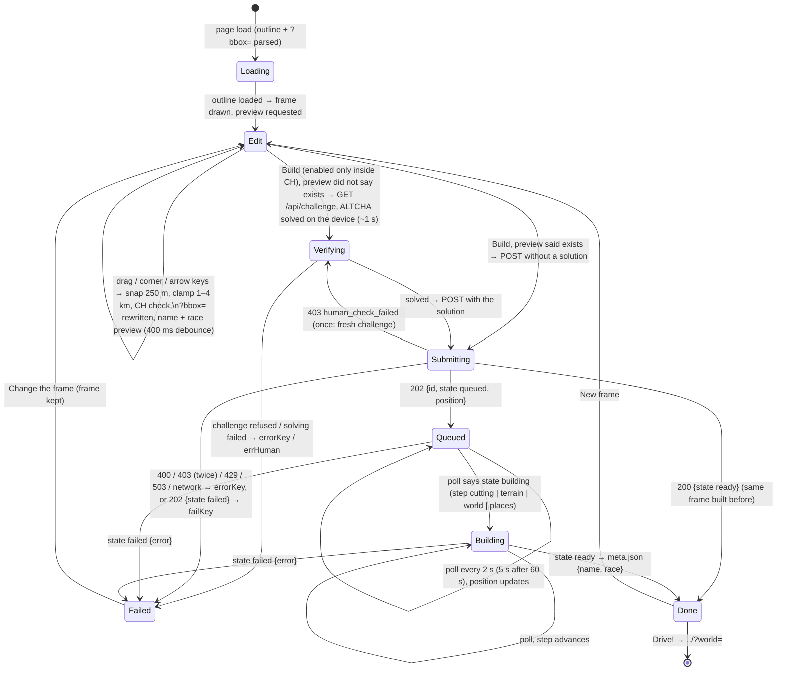

# Region editor — flow

**Keys while the frame has focus:** ← → ↑ ↓ move 250 m · Shift + ← → ↑ ↓ shrink/grow 250 m (right/up grow, left/down shrink; the
south-west corner stays) · Tab moves on to Build. The map keeps its own +/− and drag.

**Preview** (on every commit, debounced 400 ms, both in parallel, each ignored when a newer commit happened):
1. `GET api3.geo.admin.ch …/identify?geometry=<centre E,N>&layers=all:ch.swisstopo.swissboundaries3d-gemeinde-flaeche.fill&timeInstant=<year>&sr=2056` → `gemname`.
2. `GET ${API_BASE}/api/preview?bbox=e0,n0,e1,n1` → `{ id, exists, name, gemeinden, raceOk }`; `raceOk === false` → the free-driving note; `null`, 404 or an error → no note before the build; `exists === true` → Build skips the human check. No human check here.

**Polling:** `GET ${API_BASE}/api/jobs/<id>` (`state`, `step`, `position`; `expired` counts as failed); network miss → retry after the same delay, "Connection lost, retrying…" after 3 misses; never gives up. On `ready` the page reads `${API_BASE}/worlds/<id>/meta.json` (`name`, `race`) for the done card.

**URL:** `?bbox=e0,n0,e1,n1` in LV95 whole metres (snapped) is read on load and rewritten with `history.replaceState` on every commit — #167's expired-world panel links `../editor.html?bbox=…` (root stub → `editor/`).
