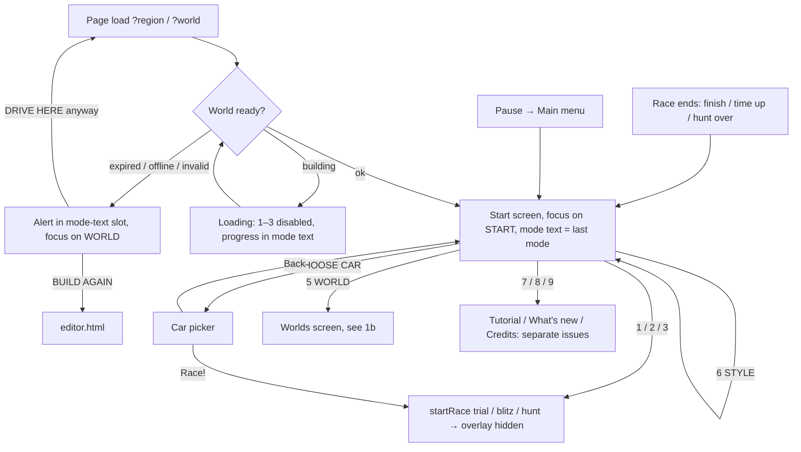
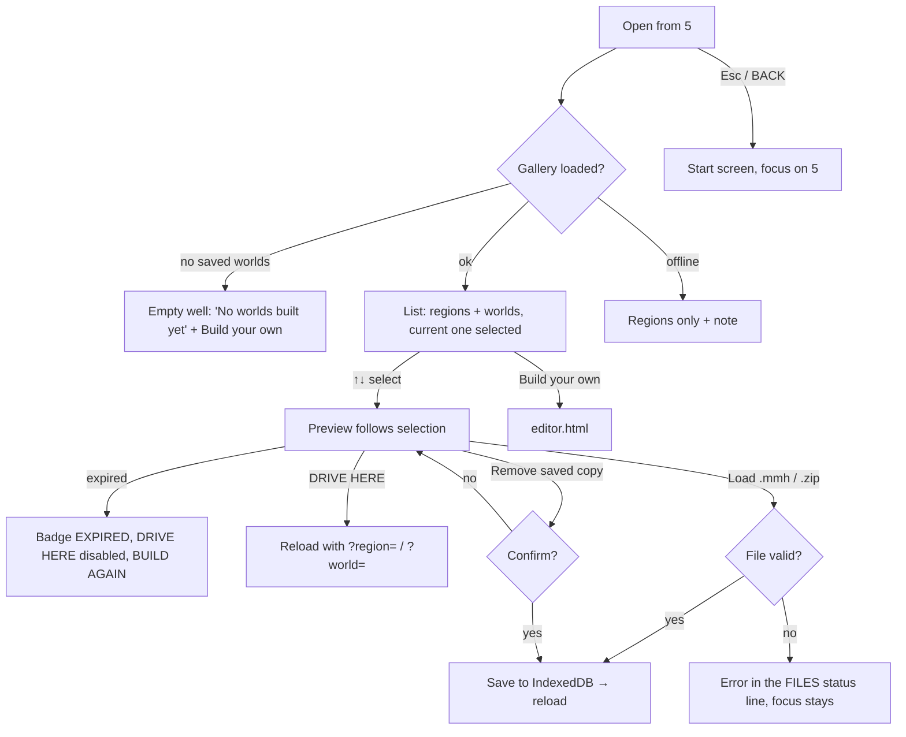
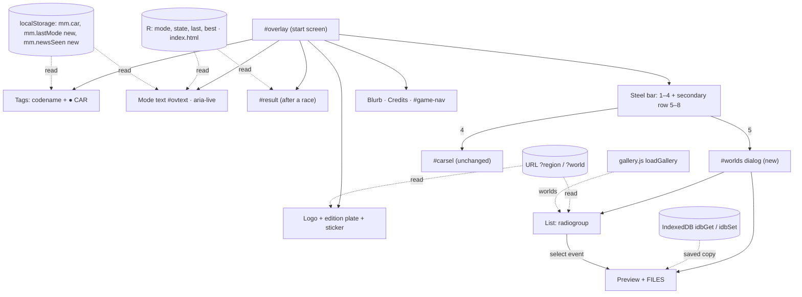

# Start screen redesign: flow

Phase 2 of the UI workflow for #346. **Approved 2026-10-17.** Wireframe: [wireframe.md](wireframe.md).

Facts from the current code (`index.html` on main, 2026-10-17):

- **Entry points to the overlay:**
  - page load (`?region=` / `?world=`);
  - race end: `finish()`, `timeUp()` and `showHuntResult()` show the overlay with `#result`;
  - Pause → main menu: `toMainMenu()`;
  - the car picker's back button: `closeCarSel()`.
- **Region, world and file changes reload the page** (`location.search = …`, `location.reload()`). A world is only built during startup.
- **Credits** (#267), **Tutorial** (#268) and **What's new** (#263) are separate open issues.

## 1a. User journey: start screen

## 1b. User journey: Worlds screen

## 2. Components and state

Data flows from the state stores into the views. Clicks call handlers: `startRace(mode)`, `openCarSel()`, `toggleStyle()`, and `location.search` for world changes. Text comes from `strings.js` via `tr()`; a `gg-langchange` event re-renders it through `rerenderAll()`.

## Decisions (screen inventory)

1. **Result view after a race:** `#result` takes the mode-text slot, the same place as the error alert, and START reads "AGAIN".
2. **Buttons 7 / 8 / 9:** each stays hidden until its issue lands (#268, #263, #267). #346 builds only the slots.
3. **World loading:** DRIVE HERE reloads the page with `?world=`, and the progress shows on the start screen. Building a world without a reload is out of scope.
4. **Remove saved copy:** an inline "Really remove? Yes / No" confirmation instead of a dialog.
5. **New localStorage keys:** `mm.lastMode` (the mode text shows the last played mode) and `mm.newsSeen` (the NEW dot, once #263 lands).
